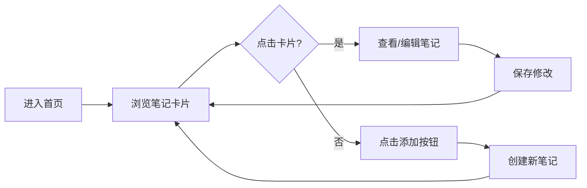

## 1. Product Overview
无敌炫酷记事本 - 一款具有极致视觉体验和强大功能的笔记应用，采用霓虹赛博朋克风格设计，支持实时预览、多种主题切换、智能搜索和动画效果。

## 2. Core Features

### 2.1 User Roles
| Role | Registration Method | Core Permissions |
|------|---------------------|------------------|
| Normal User | Local storage | Create, edit, delete notes |

### 2.2 Feature Module
1. **首页/笔记列表**: 炫酷的笔记卡片展示、霓虹动画效果、搜索过滤
2. **笔记编辑器**: 富文本编辑、实时预览、标签管理
3. **设置/主题**: 多种霓虹主题切换、字体样式调整

### 2.3 Page Details
| Page Name | Module Name | Feature description |
|-----------|-------------|---------------------|
| 首页 | 笔记卡片墙 | 瀑布流布局，卡片悬浮效果，霓虹边框发光，点击展开/收起 |
| 首页 | 搜索栏 | 实时搜索过滤，输入时动画效果 |
| 首页 | 添加按钮 | 炫酷的浮动按钮，点击展开创建表单 |
| 编辑器 | 富文本编辑 | Markdown支持，实时预览，打字机效果 |
| 编辑器 | 标签系统 | 彩色标签，拖拽排序 |
| 设置 | 主题切换 | 赛博朋克、暗夜紫、极光绿、火焰橙等主题 |

## 3. Core Process
用户进入首页 → 浏览笔记卡片 → 点击卡片查看详情 → 编辑或创建新笔记 → 保存到本地存储

## 4. User Interface Design

### 4.1 Design Style
- **主色调**: 深邃黑色背景 (#0a0a0f)，霓虹粉 (#ff00ff)、霓虹蓝 (#00ffff)、霓虹绿 (#00ff00)
- **按钮风格**: 发光边框、渐变填充、悬浮时放大效果
- **字体**: 标题使用 'Orbitron' 赛博朋克风格字体，正文使用 'Rajdhani' 现代字体
- **布局**: 卡片式瀑布流，深色背景配霓虹发光效果
- **动画**: 页面加载时卡片逐个飞入、悬浮时发光增强、按钮点击波纹效果

### 4.2 Page Design Overview
| Page Name | Module Name | UI Elements |
|-----------|-------------|-------------|
| 首页 | 头部 | 渐变背景、霓虹标题、搜索框带发光边框 |
| 首页 | 笔记卡片 | 深色卡片、霓虹边框、悬浮时发光、卡片翻转效果 |
| 首页 | 添加按钮 | 圆形浮动按钮、霓虹发光、点击展开动画 |
| 编辑器 | 编辑区域 | 半透明背景、霓虹光标、打字机音效提示 |
| 设置 | 主题选择 | 圆形主题色板、点击选中动画 |

### 4.3 Responsiveness
- 桌面端: 4列瀑布流，悬浮效果完整展示
- 平板端: 2列布局
- 移动端: 单列布局，底部导航栏

### 4.4 特殊视觉效果
- 背景粒子动画效果
- 卡片悬浮时的3D旋转效果
- 霓虹文字发光效果
- 页面切换过渡动画
