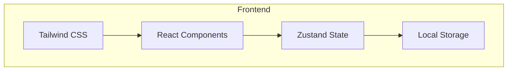
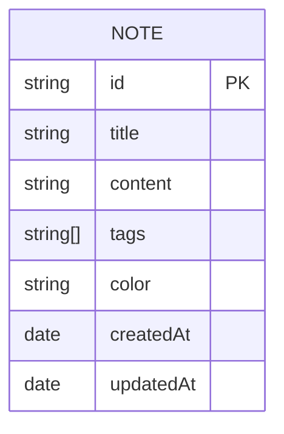

## 1. Architecture Design



## 2. Technology Description
- Frontend: React@18 + TypeScript + tailwindcss@3 + vite
- Initialization Tool: vite-init
- State Management: Zustand
- Styling: Tailwind CSS 3 + Custom CSS animations
- Icons: Lucide React
- Data Storage: Local Storage
- Fonts: Google Fonts (Orbitron, Rajdhani)

## 3. Route Definitions
| Route | Purpose |
|-------|---------|
| / | 首页 - 笔记列表卡片墙 |
| /note/:id | 笔记详情/编辑页面 |
| /settings | 主题设置页面 |

## 4. API Definitions
无后端API，所有数据存储在Local Storage中

## 5. Data Model

### 5.1 Data Model Definition


### 5.2 Data Structure
```typescript
interface Note {
  id: string;
  title: string;
  content: string;
  tags: string[];
  color: 'pink' | 'blue' | 'green' | 'orange' | 'purple';
  createdAt: string;
  updatedAt: string;
}

interface Theme {
  id: string;
  name: string;
  primary: string;
  secondary: string;
  accent: string;
  background: string;
  cardBackground: string;
}
```

## 6. Project Structure
```
src/
├── components/
│   ├── NoteCard.tsx        # 笔记卡片组件
│   ├── NoteEditor.tsx      # 笔记编辑器组件
│   ├── SearchBar.tsx       # 搜索栏组件
│   ├── AddNoteButton.tsx   # 添加笔记按钮
│   ├── ThemeSelector.tsx   # 主题选择器
│   ├── ParticleBackground.tsx  # 粒子背景
│   └── Header.tsx          # 头部组件
├── pages/
│   ├── Home.tsx            # 首页
│   ├── NoteDetail.tsx      # 笔记详情页
│   └── Settings.tsx        # 设置页
├── store/
│   └── notesStore.ts       # Zustand状态管理
├── utils/
│   ├── storage.ts          # Local Storage工具
│   └── helpers.ts          # 辅助函数
├── styles/
│   └── globals.css         # 全局样式和动画
├── App.tsx
├── main.tsx
└── index.css
```

## 7. Key Features Implementation
- **霓虹发光效果**: CSS text-shadow + box-shadow + animation
- **粒子背景**: Canvas动画实现
- **卡片悬浮效果**: CSS transform + transition
- **主题切换**: Tailwind CSS自定义主题 + Zustand状态
- **实时搜索**: Filter notes by title/content/tags
- **Markdown支持**: 使用简单的Markdown解析
